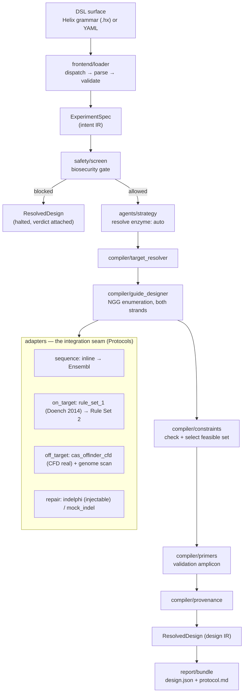
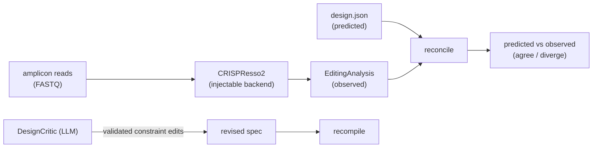

# Helix architecture

Helix compiles a declarative **intent** spec into a fully resolved **design**. The
central decision is a strict separation between three things:

1. **Intent** (`helix/ir/spec.py`) — small, human-authored, versioned in git.
2. **Orchestration** — a deterministic compiler (`helix/compiler/`) plus narrow LLM
   agents (`helix/agents/`) that only ever *fill in the spec*.
3. **Design** (`helix/ir/design.py`) — large, machine-generated, reproducible.

## Data flow

## Layers and why they are separate

| Layer | Package | Determinism | Reason to isolate |
|---|---|---|---|
| DSL frontend | `helix/frontend` | pure | swap YAML for a real grammar without touching the compiler |
| Intent IR | `helix/ir/spec` | pure | the only thing agents may write; small enough to review |
| Agents | `helix/agents` | **non-deterministic** | the *only* place LLMs live; each has a deterministic default |
| Safety gate | `helix/safety` | pure | must run before any work; every design carries a verdict |
| Compiler | `helix/compiler` | pure | testable spine; no network/RNG/wall-clock in this path |
| Adapters | `helix/adapters` | pure ↔ external | isolate messy third-party tools behind stable Protocols |
| Design IR | `helix/ir/design` | pure | reproducible record; large and machine-owned |
| Report | `helix/report` | pure | serialisation only |

## The two seams that make Helix extensible

**Adapter Protocols** (`helix/adapters/base.py`). The compiler depends only on four
structural interfaces — `SequenceProvider`, `OnTargetScorer`, `OffTargetScorer`,
`RepairOutcomePredictor`. A real tool wrapper satisfies the shape and registers a
name (`helix/adapters/registry.py`); the `simulate` block of a spec selects it by
that name. Swapping a mock for Cas-OFFinder is a **one-word spec edit**, no compiler
change. Each adapter exposes `name`/`version`, so every run is provenance-stamped.

**Agent boundary** (`helix/agents/`). Agents resolve what the spec left open
(`enzyme: auto`, via `LLMStrategyResolver`) and translate natural language into a
spec (`SpecAuthor`). An agent **never computes the design** — it only emits or edits
a spec, which the deterministic compiler then owns. Two mechanisms keep the LLM out
of the trust path:

- **Validation, not trust.** The author's output is run through the *real parser*
  (`parse_helix`); on failure it self-repairs (feeds the error back and retries) and
  gives up rather than emit invalid Helix. The strategy resolver validates the chosen
  enzyme against the set the compiler can actually design for, rejecting hallucinations.
- **Injectable LLM.** Agents depend on an `LLMClient` Protocol (`helix/agents/llm.py`),
  not a vendor SDK. The default calls Anthropic (lazy import, key from env); tests inject
  a fake, so all agent logic is covered offline. Same injectable-boundary pattern as the
  external *tools* (Ensembl, Cas-OFFinder, inDelphi), applied to the external *model*.

## Closing the loop (`helix/analysis/`)

The compiler *predicts* outcomes; a wet-lab run *produces* them. The analysis
subsystem measures reality and feeds it back:

Two feedback paths, both landing back on the *spec* (never the design directly):
the **critic** proposes constraint edits (validated against the IR, hallucinated
keys dropped) that re-compile into a new design; the **analysis loop** reconciles
predicted frameshift/efficiency against CRISPResso2's observed values. CRISPResso2
is wired like the other heavy tools — pure parsers (verified against its output
format) behind an injectable subprocess backend.

## Determinism & reproducibility

- No wall-clock, RNG, or network in the compiler or built-in adapters. Mocks derive
  numbers from a hash of the spacer.
- Ranking has a stable tie-break (`-composite_score, spacer`), so `design.json` is
  byte-stable given the same spec and adapter versions (the run timestamp is isolated
  in `Provenance`). Tested in `tests/test_pipeline.py::test_example_compiles_and_is_reproducible`.

## Roadmap → code mapping

| Phase | Work | Where it lands |
|---|---|---|
| **1 (done)** | deterministic spine, KO/SpCas9/human, offline mocks | this repo |
| **1 (done)** | Helix grammar (the named DSL), YAML frontend | `helix/frontend/helix_lang/` → same IR |
| **1 (done)** | real adapters: Ensembl sequence; Rule Set 1 (Doench 2014); Cas-OFFinder + CFD (Doench 2016); inDelphi repair | `helix/adapters/{ensembl,ontarget,offtarget,repair}.py` |
| **2 (done)** | LLM agents: NL→spec author (self-repairing); `enzyme: auto` resolver; design critic (validated spec edits); **autonomous refine loop** | `helix/agents/{llm,authoring,strategy,critic,refine}.py` |
| **2 (done)** | analysis loop: CRISPResso2 → observed editing → reconcile vs prediction | `helix/analysis/*` |
| **2 (done)** | gene databases: **Ensembl + NCBI**, retry/backoff, caching, exon-aware; `fallback` provider across sources | `helix/databases/*`, `helix/adapters/ncbi.py` |
| **2 (done)** | broadened biology: base editing (CBE/ABE/**CGBE**); prime editing (pegRNA, both strands, **substitutions + indels + PE3**, round-trip verified); **HDR knock-in** (cut-proximity guide + ssODN/dsDNA donor with homology arms + PAM-block); **dual-cut deletion**; **CRISPRi/a** (dCas9, TSS-scored); SpCas9/SaCas9/Cas12a + relaxed-PAM **SpG/SpRY/Cas9-NG** + **dCas9** | `helix/ir/enums.py` + `helix/compiler/{base_editor,prime_editor,hdr_designer,deletion_designer,regulation_designer}.py` |
| **2 (done)** | learned outcome models: **BE-Hive** (base), **PRIDICT** (prime), injectable + heuristic defaults | `helix/adapters/{base_edit_model,prime_edit_model}.py` |
| **2 (done)** | **RAG-backed strategy**: TF-IDF retrieval over a cited corpus, grounds `enzyme: auto` | `helix/agents/knowledge.py` + `strategy.py` |
| **2 (done)** | **structural simulation**: Cas9-gRNA-DNA complex → AlphaFold3/Boltz (injectable) → confidence | `helix/structure/*` |
| **2 (done)** | **web UI**: FastAPI + React/TS (spec → compile → results); 3D views — stylized helix (Three.js) + real Cas9 complex (NGL/RCSB); **interactive 3D → DSL editing** (prime: click/drag-sweep/shift-cycle a base; base-edit: click a reachable C/A to target it → rewrite `edit:` → recompile); batch/library modes + run history | `helix/server/*`, `frontend/*`, `helix/compiler/base_editor.py` |
| **2 (done)** | **delivery optimization** (RNP/plasmid/LNP/AAV advisor; AAV size limit, in-vitro/vivo) + **delivery-aware strategy** (AAV KO → SaCas9) | `helix/compiler/delivery.py`, `helix/agents/strategy.py` |
| **2 (done)** | **multiplex / library**: batch compile + gene-list library expansion | `helix/compiler/batch.py`, `/api/compile-batch`, `/api/compile-library` |
| **2 (done)** | **server-side run history**: persisted run store (survives restarts, shared) | `helix/server/store.py`, `/api/runs` |
| 3 | further learned models: Rule Set 2 / Azimuth, FORECasT/Lindel | `helix/adapters/*` (same Protocols) |
| 3 | embedding retriever; adapter composition in the grammar | `helix/agents/`; grammar |

## Language choice

Python: the CRISPR tooling you will wrap (Biopython, Azimuth, inDelphi, Cas-OFFinder
CLIs, CRISPResso2) is Python/CLI-native, so adapters are thin. Pydantic v2 gives typed,
self-validating IR with free JSON serialisation — ideal for a reproducible artifact.
