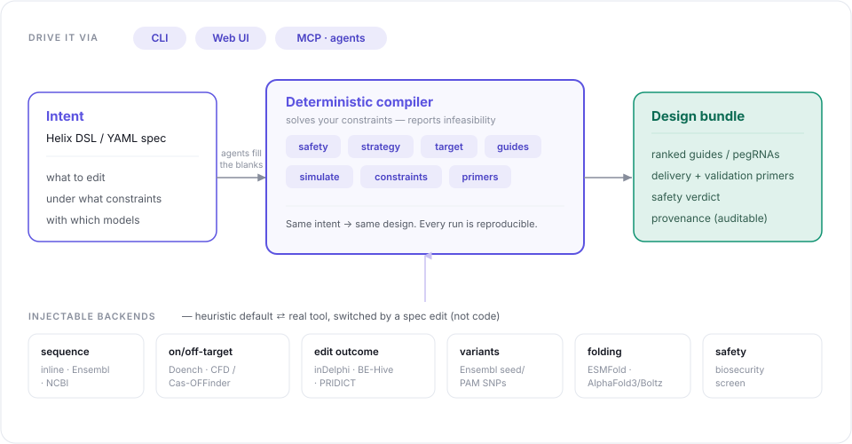
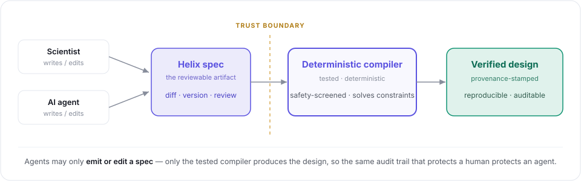

# Helix

**A declarative DSL and compiler for reproducible gene-editing design.**

[](https://pypi.org/project/helix-dsl/)
[](LICENSE)


Most agentic gene-editing tools are chat interfaces that produce a one-off
answer. Helix treats an editing experiment as **source code**: you write a small,
declarative spec (the *intent*), and a deterministic **compiler** — assisted by
narrowly-scoped LLM agents — turns it into a fully resolved, provenance-stamped
**design** you can diff, version, review, and re-run.

<p align="center">
  
</p>

The key rule: **agents may only emit or edit a spec; only the deterministic
compiler produces the design.** That keeps the trust boundary auditable and every
run reproducible.

<p align="center">
  
</p>

## Why a DSL (vs. a chat agent or plain JSON)

- **Constraints are first-class** — the compiler *solves* against them and reports
  infeasibility, instead of silently returning "the top N".
- **Diff & version in git** — review a design change like a code review; re-run when
  a genome build or model updates.
- **Clean LLM safety boundary** — the LLM proposes reviewable spec; a tested compiler
  executes. You audit the spec, not a transcript.

## Quickstart

```bash
# deps already common: pydantic>=2, pyyaml>=6
python3 -m helix.cli compile examples/tp53_ko.hx -o out    # knockout (SpCas9)
python3 -m helix.cli compile examples/tp53_base_edit.hx    # base editing (CBE/ABE)
python3 -m helix.cli compile examples/tp53_prime_edit.hx   # prime editing (pegRNA)
python3 -m helix.cli compile examples/tp53_knock_in.hx     # HDR knock-in (cut + donor)
python3 -m helix.cli compile examples/tp53_deletion.hx     # dual-cut deletion (excise a region)
python3 -m helix.cli compile examples/tp53_crispri.hx      # CRISPRi (dCas9-KRAB, TSS-scored)
python3 -m helix.cli compile examples/tp53_ko_spry.hx      # relaxed-PAM KO (SpRY, near-PAMless)
python3 -m helix.cli compile examples/tp53_ko_ensembl.hx   # resolves TP53 from Ensembl (network)
python3 -m helix.cli validate examples/tp53_ko.hx          # parse + safety screen only
python3 -m pytest -q                                        # 230 tests offline (+1 gated network test)

# Phase-2 agents (need `pip install anthropic` + ANTHROPIC_API_KEY):
python3 -m helix.cli author "knock out TP53 in HEK293T, 3 guides, avoid BsaI" -o my.hx
python3 -m helix.cli compile my.hx --strategy rag          # RAG resolves `enzyme: auto` (cited)
python3 -m helix.cli critique my.hx                        # adversarial design review
python3 -m helix.cli refine my.hx                          # autonomous critique->recompile loop

# Structure + analysis (need a folding tool / CRISPResso2):
python3 -m helix.cli structure out/design.json            # fold the Cas9-gRNA-DNA complex
python3 -m helix.cli analyze out/design.json --reads reads.fastq --coding "<cds>"
```

`compile` prints a Markdown protocol and (with `-o`) writes `out/design.json`
(the reproducible record) and `out/protocol.md` (what a bench scientist reads).

## Helix as an MCP server — gene-editing design for agents

Scientists increasingly reach for an AI agent to plan an edit. Agents are good at
*writing a constrained spec* and bad at *safely orchestrating raw bioinformatics
tools* — which is exactly the split Helix is built around. So Helix ships as an
**MCP server**: any MCP-capable agent (Claude, etc.) can drive the compiler, but
**only through the spec → compile boundary**. The agent proposes a reviewable Helix
spec; the tested, deterministic compiler produces the verified, provenance-stamped
design. The agent never touches a raw tool, so the trust boundary that makes Helix
auditable for humans holds for agents too.

```bash
python3 -m helix.mcp        # stdio JSON-RPC server (zero extra deps)   (== `helix mcp`)
```

Tools exposed: **`helix_reference`** (grammar + authoring guide + worked examples so
the agent can write a valid spec), **`helix_compile`** (spec → ranked, safety-screened
design summary with `feasible` / `safety` / `infeasibility_notes`), **`helix_resolve_gene`**
(symbol → sequence + genomic locus), **`helix_list_models`** (the selectable simulation
backends). Register it with an MCP client:

```jsonc
{ "mcpServers": { "helix": { "command": "python3", "args": ["-m", "helix.mcp"] } } }
```

This is the same pluggable-backend philosophy as the `simulate {}` adapters, pointed
the other way: MCP is simply a fourth transport (alongside HTTP/subprocess/import)
by which Helix connects agents and tools to the compiler.

## Two frontends, one IR

Helix specs can be written in the **Helix grammar** (`.hx`) or **YAML** (`.yml`); both
compile to the same `ExperimentSpec`. The CLI dispatches on file extension.

```hx
helix "TP53_KO_HEK293" {
  organism: human(GRCh38)
  profile:  strict                                  # preset tight efficiency/off-target/GC/hairpin defaults
  target: gene(TP53) { goal: knockout; region: exon(2..4) }
  strategy { modality: crispr_ko; enzyme: auto }   # `auto` -> agent chooses
  constraints {
    on_target.min_efficiency: 0.5
    off_target.max_cfd: 0.2
    gc.min: 0.4                                     # spacer GC window (folding + synthesis)
    guides.count: 3
    avoid: [ homopolymer(>=4), self_complementary(>=8), restriction_site(BsaI) ]
  }
  simulate { sequence_provider: ensembl; on_target: rule_set_1
             off_target: mock_seed; repair_outcome: mock_indel }
  deliver: rnp
  validate: amplicon_seq
}
```

**Guide-quality constraints** (first-class): a **GC window** (`gc.min`/`gc.max`), a
**hairpin/self-complementarity filter** (`self_complementary(>=n)` — the longest internal
reverse-complementary stem), homopolymer and restriction-site avoidance — each reported as a
pass/fail check in the guide drill-down. **Profiles** (`profile: strict | lenient | screen |
quick`) preset sensible defaults for a scenario; any constraint you write overrides the preset.

**Variant-aware guides.** With `simulate { variant_source: ensembl }`, Helix queries Ensembl
for **known population variants** overlapping each database-resolved guide and flags those in
the **seed/PAM** (a common SNP there abolishes binding in carriers). `avoid: [common_variant(>=0.01)]`
rejects any guide with a variant at ≥ that frequency in the seed/PAM; the drill-down lists the
overlapping variants. Behind an injectable `VariantProvider` seam (Ensembl + offline fake),
default off, so the deterministic path needs no network.

**Protein-consequence awareness.** Give the target a reading frame (`target { frame: 0 }`, the
codon phase of window position 0) and Helix answers the molecular biologist's first question about
any coding edit — *does it change the protein?* Each base-edit, prime-edit, and HDR guide carries a
consequence badge: **silent (synonymous)**, **missense** (`E>K`), **premature STOP** (a CBE "iSTOP"
knockout), **stop-loss**, or **frameshift / in-frame indel**. For **HDR** it goes further: the
PAM-blocking mutation that stops re-cutting the corrected allele is chosen to be **guaranteed
synonymous** when a silent option exists — and honestly flagged when none does. Pure standard genetic
code (`helix/codons.py`), no external tool; skipped entirely when no frame is given, so non-coding
targets are unaffected.

Grammar reference: [helix/frontend/helix_lang/GRAMMAR.md](helix/frontend/helix_lang/GRAMMAR.md).

## Status

**Modalities & enzymes.** The compiler routes by `strategy.modality` across:
**knockout**; **base editing** (CBE C→T, ABE A→G, CGBE C→G — exact editing-window
+ bystander analysis); **prime editing** (pegRNA: nick + PBS + RTT; substitutions,
insertions, deletions, plus a PE3 second nick — every pegRNA round-trip verified);
**HDR knock-in** (a nuclease cut placed close to the edit plus a homology-arm
**donor** — ssODN or dsDNA — carrying the change and a silent PAM-blocking mutation
so the corrected allele can't be re-cut); **dual-cut deletion** (two flanking guides
whose cuts bracket a region to excise); and **CRISPRi / CRISPRa** (dCas9 repression /
activation scored by TSS-relative position, no cut). Nucleases **SpCas9, SaCas9,
Cas12a**, the relaxed-PAM variants **SpG (NGN), SpRY (NRN), Cas9-NG (NG)**, and dead
**dCas9** all enumerate from an IUPAC-aware, data-driven PAM table
(`helix/ir/enums.py`) — adding an enzyme is a one-row change.

**Structural simulation.** `helix structure` assembles the Cas9–gRNA–DNA complex
(embedded 1368-aa SpCas9 + sgRNA + target duplex) into an AlphaFold3/Boltz input
and summarizes the predicted confidence (pTM/ipTM/pLDDT) — useful for hard
off-target calls. The folding tool sits behind an injectable backend (offline-tested).

**Gene database.** `helix/databases/` connects to **Ensembl and NCBI** to load the
*proper* gene — resolving a symbol to coordinates, strand, canonical transcript,
and exons, so `region: exon(2..4)` becomes real exon coordinates (verified live
against TP53 on both sources). Lookups are cached, both clients retry with backoff
on 5xx/429/timeouts, and GRCh38/GRCh37 route to their hosts. `sequence_provider:
fallback` tries Ensembl then NCBI, so a source outage no longer blocks a run —
verified live by simulating an Ensembl outage and watching NCBI serve the gene.

The deterministic spine runs fully offline using honest, clearly-labelled
heuristic/mock adapters; each is a drop-in target for a real tool behind the
**same interface**:

| role | built-in | real tool (same Protocol) | status |
|---|---|---|---|
| sequence | `inline` | **`ensembl`**, **`ncbi`**, **`fallback`** (Ensembl→NCBI) | ✅ both live + fallback |
| on-target | `heuristic_gc` | **`rule_set_1`** (Doench 2014) → Rule Set 2 / Azimuth | ✅ Rule Set 1 wired |
| off-target | `mock_seed` | **`cas_offinder_cfd`** (CFD real; scan needs a genome) | ✅ CFD wired |
| repair outcome | `mock_indel` | **`indelphi`** (needs the inDelphi package) | ✅ wired (injectable) |
| base-edit outcome | `window_heuristic` | **`behive`** (BE-Hive, Arbab 2020) | ✅ wired (injectable) |
| prime-edit outcome | `pe_heuristic` | **`pridict`** (PRIDICT, Mathis 2023) | ✅ wired (injectable) |

`sequence_provider: ensembl` resolves a gene symbol against GRCh38 and fetches a
bounded edit window; `on_target: rule_set_1` scores guides with the published
Doench 2014 model; `off_target: cas_offinder_cfd` scores off-targets with the
Doench 2016 CFD model (both verified against reference implementations).

Real off-target scanning needs [Cas-OFFinder](https://github.com/snugel/cas-offinder)
and a genome — set `HELIX_GENOME_DIR` (and optionally `HELIX_CASOFFINDER_BIN`).
Real repair outcomes need the [inDelphi](https://github.com/maxwshen/inDelphi-model)
package. Without them, `cas_offinder_cfd` / `indelphi` raise a clear error; the
`mock_*` adapters keep the pipeline fully runnable offline.

The verified-real cores (Doench 2014, Doench 2016 CFD) are pure and always on;
the heavy models (Cas-OFFinder, inDelphi) sit behind injectable boundaries so the
integration is tested offline and configured in only when a genome/model is present.

### Phase 2 — agents

Two LLM agents, both holding the trust boundary that defines Helix (**agents only
emit/edit specs; the deterministic compiler owns the design**):

- **`helix author "<request>"`** — natural language → a reviewable `.hx` spec. The
  model's output is *validated by the real parser*; on a parse error the agent
  self-repairs (feeds the error back and retries), so it never emits invalid Helix.
- **`compile --strategy llm` / `--strategy rag`** — an LLM resolves `enzyme: auto`,
  validated against the enzymes the compiler can actually design for (hallucinated
  enzymes rejected, deterministic fallback). The **RAG** variant grounds the choice
  in a retrieved, **cited** literature corpus (TF-IDF over landmark references).
- **`helix critique`** — an adversarial reviewer flags weaknesses and proposes
  **constraint edits validated against the IR** (unknown/out-of-range edits are
  dropped), which re-compile into an improved design.
- **`helix refine`** — runs that loop **autonomously**: critique → apply validated
  edits → recompile, until it converges (no new edits, or a no-op), with a guardrail
  that refuses edits which would make a feasible design infeasible, and a hard
  iteration cap.

The LLM sits behind an injectable `LLMClient`, so agent logic is fully tested
offline with a fake client — no network or key needed.

### Closing the loop — analysis

`helix analyze` runs [CRISPResso2](https://github.com/pinellolab/CRISPResso2) on
amplicon reads and **reconciles observed editing against the design's prediction**
(inDelphi frameshift, Doench efficiency), flagging agreement or divergence. That
turns Helix from a one-shot designer into a **design → validate → analyse** loop:
the critic feeds edits back into the spec, and observed data feeds back into the
next design. CRISPResso2 is wired behind an injectable backend (pure parsers,
verified against its output format), so the loop is tested offline.

### Web UI

An interactive frontend (React + TypeScript, Vite) talks to a FastAPI backend that
wraps the compiler — write a spec, compile, and inspect the ranked guides / pegRNAs,
outcome metrics, feasibility, safety verdict, provenance, and a **delivery
recommendation**, in Helix's own "scientific instrument" visual identity. Three result views
(**Table · 3D helix · Cas9 complex**) — the helix is **interactive**: it rewrites the DSL
`edit:` line and recompiles (a 3D → spec round-trip). In a prime-edit or HDR knock-in design
you *click* a base to place the edit, *drag* to sweep the position live, or *shift-click* to
cycle the substituted base; in a base-edit design you *click* a highlighted base (only the C/A
a guide can actually reach are pickable) to target it, and the compiler keeps the guides that
edit it. HDR designs also render the **donor** (homology arms + insert + PAM-block status).
**Batch** and **Library** modes (compile many specs at once, or one base spec across a gene
list — a multiplex/library run), and a **server-persisted run history** (survives restarts
and is shared across clients).

**AI assist** (opt-in) surfaces the agent layer in the UI: a **"Describe it"** box turns
plain English into a reviewable `.hx` spec (the self-repairing author agent — its output is
validated by the real parser before it lands in the editor), and a **"Critique current spec"**
button runs the design critic, showing findings and applying its *validated* constraint edits
back into the spec to recompile. It defaults to the cheap **Claude Haiku 4.5** (per-request
Sonnet toggle) and shows a token-cost readout per call. The features are gated on a backend
API key — set `ANTHROPIC_API_KEY` and `pip install anthropic` to enable them; without a key
the panel degrades to a hint and everything else stays fully offline. (`HELIX_FAKE_LLM=1`
runs a canned offline stub to preview the flow without a key.)

```bash
# One-command product: build the UI once, then serve UI + API on one origin.
cd frontend && npm install && npm run build && cd ..
pip install -e '.[web]' && helix serve       # full app on http://localhost:8000

# Or hot-reload dev (two processes):
helix serve                                   # API on :8000 (+ /docs)
cd frontend && npm run dev                     # UI on :5173 (proxies /api)
```

Backend: `helix/server/app.py` (`/api/compile`, `/api/compile-batch`,
`/api/compile-library`, `/api/examples`, `/api/validate`, `/api/author`, `/api/critique`,
`/api/structure`, `/api/resolve`, `/api/adapters`, `/api/fold`, `/api/export`, `/api/analyze`).
The app shell is a sidebar (**Design · Batch · Library · Compare · Models · History**) +
workspace; the guide table drills down to off-targets/context on click.

**From design to bench, and back.** Every design carries an **Order-ready oligos** card —
guide cloning oligos (BsmBI/BbsI Golden Gate), pegRNA 3' extensions, ssODN donors, and
validation primers — as a table + downloadable IDT CSV with a rough cost (`/api/export`). And
an **Analyze results** card closes the loop: paste amplicon reads (FASTQ/FASTA/plain, or load
synthetic example reads) and Helix quantifies editing efficiency + an indel spectrum with a
pure-Python anchor caller, then **reconciles observed vs predicted** (inDelphi frameshift,
Doench) — no CRISPResso2 install required (`/api/analyze`).

**Databases in the UI.** The **Gene database** box (Design view) resolves a symbol to its
edit-window sequence **live from Ensembl / NCBI** (`/api/resolve`, the same providers
`sequence_provider:` uses) and inserts it into the spec. The **Models** view (`/api/adapters`)
lists every database and simulation model Helix connects to — sequence provider, on-target,
off-target, repair, base/prime-edit, and folding — tagged verified / heuristic / mock /
external-tool / database / remote, with a live "ready / needs-setup" status.

**Real structure prediction.** The Complex tab's **Fold with ESMFold** runs *real* protein
structure prediction (ESMFold public API, no key/GPU) on a SpCas9 domain and renders the model
coloured by per-residue pLDDT confidence (`/api/fold`). The full Cas9-gRNA-DNA complex still
needs AlphaFold3/Boltz behind the `StructureBackend` seam (`HELIX_FOLDING_BIN`, GPU).
Frontend: `frontend/` (see its README). The API is thin — all design logic stays in
the library, so the CLI and UI share one code path.

**Delivery optimization** (`helix/compiler/delivery.py`) recommends a delivery method
(RNP / plasmid / LNP / AAV) from the editor's cargo size, modality, and in-vitro vs
in-vivo context — honouring the ~4.7 kb single-AAV limit (base/prime editors overflow
it) and RNP's transient low-off-target profile. Shown in every design and the CLI protocol.
This also feeds a **delivery-aware strategy** (the default resolver): an AAV knockout with
`enzyme: auto` selects the compact **SaCas9** that fits single-AAV, rather than SpCas9 — and
the advisor reconciles the two, noting when an enzyme was auto-selected to honour an AAV request.

**Server-side run history** (`helix/server/store.py`) persists compiled runs to disk
(`/api/runs`), so the UI's history survives restarts and is shared across clients — set
`HELIX_RUNS_PATH` to choose the file (default `~/.helix/runs.json`). Repeat runs of one
design (interactive 3D edits, re-compiles) **coalesce** into a single, latest-state entry
rather than piling up; distinct designs — including each gene in a library run — stay separate.

**Library / batch** (`helix/compiler/batch.py`) compiles many specs independently
(`compile_batch`) or expands one base spec across a gene list (`library_specs`) for a
knockout/edit library.

See [ARCHITECTURE.md](ARCHITECTURE.md) for the layering, extension points, and roadmap.
